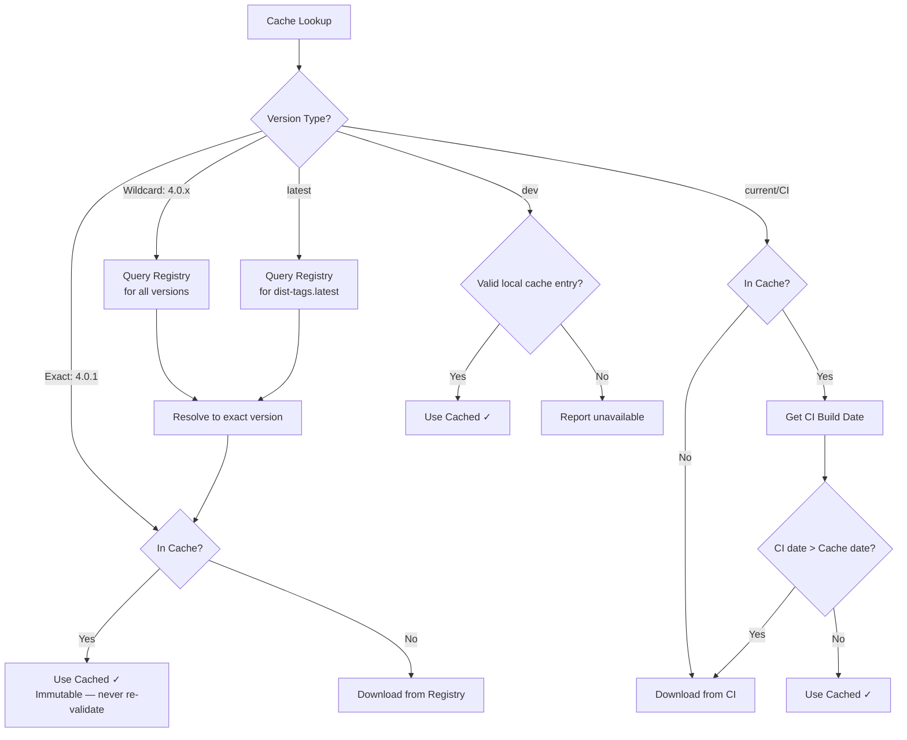

# Package Caching

FHIR packages are cached locally to avoid redundant downloads and support offline operation. This document describes the cache structure, validation strategies, and cache management.

## Cache Location

All implementations use a shared cache directory:

| Platform | Default Path |
|----------|-------------|
| Linux / macOS | `~/.fhir/packages/` |
| Windows | `%USERPROFILE%\.fhir\packages\` |

> **Note:** The Java Publisher IG Loader uses `~/fhircache` (without `.fhir`) in some modes, and `%TEMP%/fhircache` for autobuild and webserver modes.

FhirPkg resolves the cache path from the `PACKAGE_CACHE_FOLDER` environment
variable, then the `CachePath` option (CLI `--package-cache-folder`), and
otherwise `~/.fhir/packages`.

## Directory Structure

Each package version occupies its own directory within the cache, named with the FHIR directive format (`{name}#{version}`):

```
~/.fhir/packages/
├── packages.ini                          # Cache metadata (optional)
├── .fhirpkg/                             # FhirPkg-owned hidden state
│   ├── locks/                            # persistent identity/global/operation lock files
│   ├── staging/                          # bounded compressed and expanded operation data
│   ├── transactions/                     # durable transaction journals
│   ├── backup/                           # prior valid generations during replacement
│   └── quarantine/                       # prior corrupt artifacts during repair
├── hl7.fhir.r4.core#4.0.1/
│   └── package/
│       ├── package.json                  # Package manifest
│       ├── .index.json                   # Resource index (from publisher)
│       ├── .firely.index.json            # Extended index (Firely-generated)
│       ├── StructureDefinition-Patient.json
│       ├── ValueSet-*.json
│       └── ... (other FHIR resource files)
├── hl7.fhir.us.core#6.1.0/
│   └── package/
│       └── ...
├── hl7.fhir.us.core#current/
│   └── package/
│       └── ...
└── ...
```

**Key conventions:**

- Directory names use `#` as the separator (FHIR-style directive)
- FhirPkg uses a reversible lowercase-safe encoding when identity characters
  are unsafe for portable paths/INI keys; `PackageRecord.Reference` preserves
  the requested display identity
- Standard archives retain safe root files and sibling trees beside `package/`;
  the selected content directory remains `package/`
- Ordinary root-layout installs wrap the complete archive once in `package/`;
  unmodified root-layout installs use the identity root as the content directory
- Only top-level `.json` files in the selected content directory are scanned
  for FHIR resources (not sibling trees or subdirectories)
- CI builds use `current` as the version component (e.g., `hl7.fhir.us.core#current`)

## Cache Metadata (`packages.ini`)

Some implementations maintain an INI-format metadata file:

```ini
[cache]
version = 3

[urls]

[local]

[packages]
hl7.fhir.r4.core#4.0.1 = 20240115120000
hl7.fhir.us.core#6.1.0 = 20240116083000
hl7.fhir.us.core#current = 20240120150000

[package-sizes]
hl7.fhir.r4.core#4.0.1 = 52428800
hl7.fhir.us.core#6.1.0 = 1048576
```

| Section | Contents |
|---------|----------|
| `[cache]` | Cache format version |
| `[packages]` | Directive → download datetime (`YYYYMMDDHHmmss`) |
| `[package-sizes]` | Directive → whole archive's expanded file bytes, including siblings and supplied indexes |
| `[package-source-publication-dates]` | Mutable-source publication timestamp |
| `[package-archive-sha256]` | SHA-256 of the installed compressed archive |
| `[package-content-generations]` | Content-generation counter for atomic replacement |

FhirPkg writes `packages.ini` atomically under the cache-wide mutation lock and
preserves unrelated/unknown sections.

`PackageRecord.SizeBytes` uses that original expanded-archive measurement;
later derived index creation or replacement does not recalculate it. The
bookkeeping here belongs to the **cache root**. Distributed `packages.ini` or
`.fhirpkg` entries inside a package target are ordinary payload, not control
state or persistent protection markers.

Project restore resolution state is not part of the cache. Each restore reads
the current manifest and resolves the live registry/cache graph, while the
identity, global, and operation locks described below continue to coordinate
package-cache mutation.

## Cache Validation Strategies

Different version types require different cache validation approaches:



### Exact Versions

- **Single cache lookup** by directory name
- **Never re-validated** — published exact versions are immutable
- If not in cache, download once and store permanently

### Wildcard / Latest Versions

- **Always query the registry** to resolve to an exact version
- Wildcard literals never appear in cache directory names
- The resolved exact version is cached using its actual version number
- Example: `4.0.x` resolves to `4.0.1` → cached as `package#4.0.1`

### CI Build Versions

- **Always compare dates** with the CI build server
- Cached with the version tag (e.g., `package#current`)
- Download the CI manifest to get the current build date
- Compare against the cached `package.json` date
- Re-download if the CI build is newer

### Dev Versions

- Local-only and authoritative
- A valid local cache entry is returned even when overwrite was requested
- If not in cache, no registry or CI fallback is attempted

## Installation Process

When a package is installed through FhirPkg, it goes through these steps:

```mermaid
sequenceDiagram
    participant Client
    participant Stage as Cache-local staging
    participant Cache as Cache Directory

    Client->>Cache: Acquire identity lease
    Client->>Stage: Bounded copy + incremental hashes
    Client->>Stage: Bounded extraction and portable-path validation
    Client->>Stage: Locate authoritative content; validate manifest and identity
    Client->>Stage: Wrap entire root-layout archive only in ordinary mode
    Client->>Cache: Acquire short global mutation lease
    Client->>Cache: Write durable journal
    Client->>Cache: Same-volume generation rename/promotion
    Client->>Cache: Atomically replace packages.ini
    Client->>Cache: Complete journal / remove obsolete artifact
```

### Package Normalization

Installation separates safe extraction, read-only content discovery, identity
validation, and mode-dependent preparation. Authority is the exact regular-file
slot `package/package.json` or root `package.json`. Both regular candidates in
one archive are rejected, even if identical; an invalid selected manifest does
not trigger fallback to an arbitrary nested manifest. Other safe manifests,
including malformed ancillary JSON, are opaque payload.

| Archive / mode | Identity-directory payload | Selected content directory |
|----------------|----------------------------|----------------------------|
| Standard / ordinary | Complete distributed archive, including all safe siblings and root files | `package/` |
| Standard / unmodified | Same distributed archive | `package/` |
| Root-layout / ordinary | Complete archive wrapped once beneath `package/` | `package/` |
| Root-layout / unmodified | Complete archive without a wrapper | Identity root |

Standard `openapi/`, `other/`, arbitrary sibling roots, root files, empty
directories, and ancillary indexes remain at their original relative paths.
There is no ancillary relocation or merge, even when a same-named directory
also exists inside `package/`. Ordinary root wrapping moves **all** payload as
one tree, including an incidental `package` file/subtree, preserving internal
relationships while providing the standard representation expected by tools.
The wrapper is prepared wholly within the owned operation before journaling.

`PackageRecord.DirectoryPath` is the complete identity root.
`PackageRecord.ContentPath` is the selected content directory, and may equal
`DirectoryPath` for a preserved root. Use `DirectoryPath` to access known
standard siblings. SDK content-file and resource reads remain contained in
`ContentPath`; `../` is not permitted as a way to reach those siblings.

`FhirPackageManagerOptions.Unmodified` and `InstallCacheOptions.Unmodified`
are optional booleans defaulting to `false`. The manager snapshots its value at
construction for every source route, import, batch/dependency installation,
restore, and eager/lazy/forced index operation. The low-level cache option
controls one direct install/import invocation. The CLI supports `--unmodified`
and the `unmodified` configuration key.

This is a runtime payload policy, not a read-only cache or a per-package
protection flag. Acquisition, extraction, staging, cache-root metadata/journals,
recovery, and explicit whole-package overwrite, removal, and clean remain
available. A later ordinary process can maintain an index even in a raw root.
A cache hit returns its existing generation without reconstructing historical
paths/index bytes. To reinstall from a source under another mode, explicitly
use SDK `OverwriteExisting` or CLI `install --overwrite`, not `install --force`.

**Compatibility warning:** older SDKs and external tools may reject preserved
root-layout entries as corrupt or modify them. The mode does not restrain other
processes/tools. Prefer a **dedicated cache** when using raw roots alongside
such consumers.

Native filesystem Unicode behavior still applies. Extraction writes exact safe
spelling and checks both exact/canonical limits while rejecting canonical
case/Unicode collisions; filesystems that normalize names can still change
visible spelling. Fidelity tests compare actual enumerated names and bytes
against independent direct-file controls and report native limitations, not
silently normalize both expected and actual strings.

The standalone `TarballExtractor.NormalizePackageStructure` remains an
explicitly mutating, narrow compatibility utility with its existing optional
lowercase `openapi/` / `other/` allowlist and occupied-destination rejection.
Installation no longer invokes that policy. Publish identity discovery and
standard-only NPM validation retain their compatibility bridge unchanged.

### Index Generation

FhirPkg ordinary managers reuse a usable schema-v2 active `.index.json` unless
forced, and atomically generate/replace a missing, unusable, or forced index
under identity/generation coordination. The active target is in `ContentPath`,
not necessarily `package/`. Unmodified managers reuse valid publisher bytes or
build and register a validated index in memory; missing/unusable targets remain
untouched, even for `ForceReindex`. No payload temporary file is written.
An occupied `.index.json` directory is never deleted to make room for a file:
ordinary persistence fails, whereas unmodified indexing can remain in memory.
Ancillary indexes elsewhere are never active-index maintenance targets.

`DiskPackageCache.GetIndexAsync` reports only usable on-disk indexes, not a
manager's transient state. Unmodified fresh processes may rebuild in memory;
ordinary later processes may persist. Explicit/lazy indexing failures surface
to callers, while eager indexing failures warn without undoing installation.
Unmodified manager construction rejects unsupported injected caches/indexers
early, before source reads or mutating callbacks (`UnsupportedCacheCapability`
/ `PolicyValidation` for caches, `NotSupportedException` for indexers).
Ordinary custom-collaborator support is unchanged; no public capability
framework is added.

Implementations may generate their own resource indexes on installation:

- **Firely:** Generates `.firely.index.json` with extended metadata (canonical URLs, resource types, titles, descriptions, snapshots, expansions)
- **CodeGen:** Reads the existing `.index.json` from the package
- **SUSHI:** Builds an in-memory SQLite index on load

## Resource Discovery

Clients discover resources within cached packages by:

1. **Index-based** (preferred): Read `.index.json` or `.firely.index.json` for a pre-built catalog
2. **Directory scan**: List top-level `.json` files in the selected content directory (excluding subdirectories)
3. **Parse and classify**: Read each JSON file to determine its `resourceType` and metadata

## Cache Eviction

Use `IPackageCache.RemoveAsync`, `IFhirPackageManager.RemoveAsync`, or their
clear methods. These operations coordinate with installs, journal the mutation,
recover after interruption, and update metadata. Manual directory deletion is
outside the SDK coordination contract and may leave corrupt targets or stale
metadata. Persistent files under `.fhirpkg/locks` are intentionally retained.

## Concurrent Access

FhirPkg coordinates SDK users of one cache root across threads, manager/cache
instances, and processes:

- identity-specific `SemaphoreSlim` and persistent OS file locks serialize
  install, overwrite, repair, remove, and SDK reads for one canonical identity;
- unrelated identities acquire, hash, validate, and extract concurrently;
- a separate global lock covers only promotion, metadata, remove, and clear
  mutations;
- known-identity waiters revalidate after locking and return the winner without
  reading their source unless overwrite was requested, even with different
  runtime modes;
- discovery imports may each perform bounded staging before identity is known,
  then converge after locking;
- process termination releases OS ownership; the next identity owner recovers
  its durable journal before abandoned staging cleanup; and
- `ClearAsync` has snapshot semantics, so installs begun outside its snapshot
  may finish afterward.

These guarantees apply only to SDK operations that honor `.fhirpkg/locks`.
External tools and callers directly using a previously returned raw path are
not locked. During a two-rename replacement, such a raw-path caller may briefly
observe the target absent, but never a mixed generation.

## Disk Cache vs. In-Memory Cache

### Disk Cache

The primary cache. Persists across sessions and is shared between tools:

- Location: `~/.fhir/packages/`
- Used by: All implementations
- Persistence: Until manually deleted

### In-Memory Resource Cache

An optional LRU cache for frequently accessed resources:

| Implementation | Default Size | Configuration |
|---------------|-------------|---------------|
| SUSHI/fhir-package-loader | 200 entries | `resourceCacheSize` option |
| FhirPkg | 200 entries | `ResourceCacheSize` option (`ResourceCacheSafeMode`) |
| CodeGen | Not built-in | — |

Both the SUSHI and FhirPkg implementations support three safety modes for the in-memory cache:

| Mode | Behavior | Performance |
|------|----------|-------------|
| `OFF` | Returns cached reference directly | Fastest — caller must not mutate |
| `CLONE` | Deep clones resources from cache | Slowest — safest for mutation |
| `FREEZE` | Recursively freezes resources | Middle — prevents accidental mutation |

### Browser Cache

The SUSHI implementation also provides a browser-compatible cache using IndexedDB:

- Each package stored as an IndexedDB object store
- Keyed by `{name}#{version}`
- Schema: `{ keyPath: ['resourceType', 'id'] }`
- Does not support `current` or `dev` versions
- Must be initialized with the full dependency list upfront
